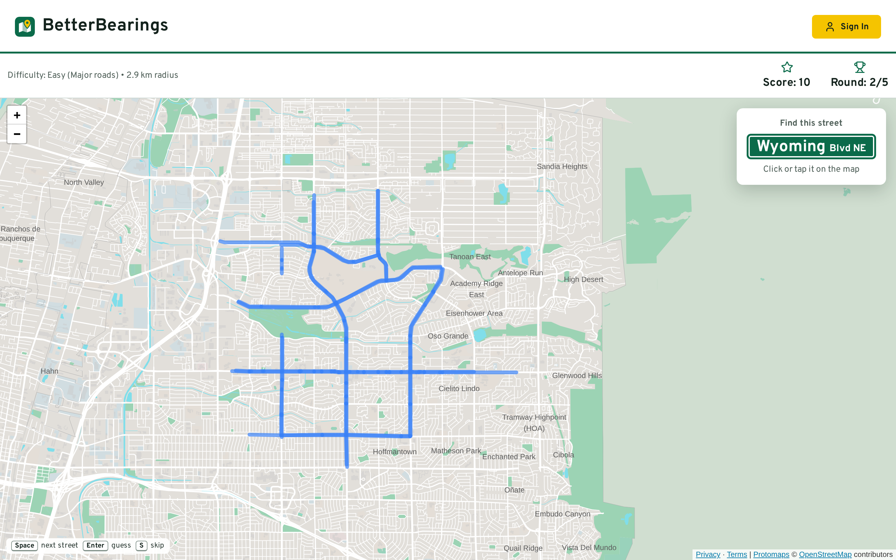
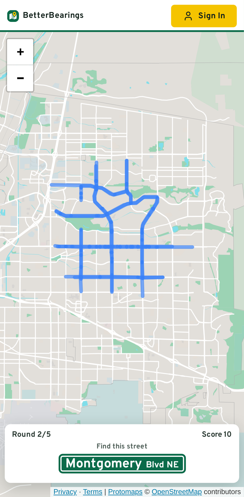

# BetterBearings

Finally, a learning experience for the directionally challenged.

BetterBearings is a map game for learning street names. You pick an area, the game shows a street name on a street sign, and you click or tap that street on the map. Play as a guest, or sign up to save street sets for the neighborhoods you want to learn. It covers New Mexico for now.

[](https://github.com/LoamySand/BetterBearings/actions/workflows/ci.yml?query=branch%3Amain)


**Play it at [betterbearings.net](https://betterbearings.net).**

<p>
  
  
</p>

## Features

- **Quiz any area:** pan and zoom the map, and the circle (500 m to 5 km) sets which streets are quizzed, up to 10 questions a game.
- **Three levels:** Easy plays major roads, Medium adds tertiary roads, and Hard plays every named street.
- **Street sets:** with an account, save up to 200 streets from an area, leave out the ones you don't want, and replay the set at any level.
- **Keyboard play:** Space moves between streets, nearest the center first; Enter guesses and S skips.
- **Accounts:** password reset by email, and account deletion from the profile menu.
- **No tracking:** no cookies, analytics or ads. The [privacy policy](https://betterbearings.net/privacy) lists what is stored.

## Roadmap

- **Nationwide coverage:** street data and map tiles for every US state, not just New Mexico.
- **Cycling mode:** streets and paths chosen for riding.
- **Competitive mode:** scoring that counts how quickly each street is found.
- **Build your own street sets:** pick streets by hand from every street in an area, not just the 200 the game chooses.

## Tech stack

| Layer        | Tools                                                                                                                 |
| ------------ | --------------------------------------------------------------------------------------------------------------------- |
| Client       | React 19, Vite, React Router, Leaflet with self-hosted Protomaps vector tiles (protomaps-leaflet)                      |
| Server       | Node 24, Express 5, zod validation, pino logging, helmet (strict CSP), express-rate-limit, Resend for email           |
| Database     | PostgreSQL 17 + PostGIS 3.5 through node-postgres, with parameterized SQL and no ORM; migrations with node-pg-migrate |
| Street data  | OpenStreetMap (Geofabrik New Mexico extract), loaded with osm2pgsql and a flex style, rebuilt weekly                  |
| Tests and CI | node:test and supertest against a PostGIS service container in GitHub Actions                                         |
| Deploy       | Docker image on GHCR, Docker Compose on a home server behind Cloudflare Tunnel, deployed from CI over Tailscale        |

## How it works

- **Street data lives in PostGIS.** Every Sunday a job downloads the Geofabrik New Mexico extract, loads its named roads into `osm.streets` with osm2pgsql, and swaps the new table in within one transaction, so the game keeps running. It refuses the swap if the new import has under 90% of the current rows, which is what a cut-off download looks like.
- **The server picks each game's streets.** `/api/streets` finds every road in the circle, merges each street's segments by name, and gives the street the level of its main road class: a mostly secondary road with a tertiary end counts as Easy. Its 200-street pool is dealt evenly across the levels, so a Hard game isn't all side streets.
- **The map is self-hosted.** A z15 New Mexico Protomaps archive (about 286 MB) is served from the same server and cached by Cloudflare. No map view goes to an outside map service.
- **Street sets are stored as `geometry(MultiLineString, 4326)`,** one row per street. The client works in `[lat, lng]` and PostGIS stores `[lng, lat]`; the data layer swaps both directions, and a test checks the stored order directly in PostGIS.
- **Request limits come from measured data.** A dense 200-street set is about 313 KB, so street-set bodies are capped at 1.5 MB, and every other endpoint at 10 KB.
- **Street sets are scoped to their owner.** Another user's set returns 404, not 403, so its existence isn't revealed.
- **Password reset links work once, for 30 minutes.** Only a SHA-256 hash of each token is stored, and the token travels in the link's fragment, so it never reaches a request log. A reset signs out every device. A request gets the same reply whether or not the address has an account.
- **Deleting an account** requires the password again and cascades to the user's sets and streets through foreign keys.
- **Production runs on a home server with no open router ports.** Cloudflare Tunnel carries public traffic, Postgres has no published port, and CI deploys over Tailscale with an SSH key that can only run the deploy script. A push to `main` deploys production; other release branches deploy staging. A failed health check rolls back to the previous image.
- **Backups are tested.** Nightly `pg_dump` with 14 days kept, a weekly age-encrypted copy to Google Drive kept for 8 weeks, and a script that restores the newest dump into a throwaway container and compares row counts with the live database.

## Running locally

See [QUICKSTART.md](QUICKSTART.md) for setup: Node 24, the PostGIS container, environment variables, migrations, production deploys, restoring a backup, and troubleshooting.

Common commands, from the repo root:

| Command                              | What it does                                         |
| ------------------------------------ | ---------------------------------------------------- |
| `npm run dev --prefix server`        | API on port 5000, restarts on change                 |
| `npm start --prefix client`          | Vite dev server on port 3000, proxies `/api`         |
| `npm test --prefix server`           | API tests against the `betterbearings_test` database |
| `npm test --prefix client`           | Client unit tests                                    |
| `npm run migrate up --prefix server` | Apply database migrations                            |
| `npm run lint` / `npm run lint:fix`  | ESLint and Prettier                                  |

## Project layout

```
client/
  brand/           sources and scripts for the icons, link preview and README screenshots
  public/          icons, manifest, robots.txt
  src/
    components/    game, quiz panel, header, sign-in, street-set and delete dialogs
    contexts/      auth state and auth API calls
    hooks/         maps, quiz circle, street loading, polylines, keyboard play
    pages/         home, street sets, reset password, privacy, terms, 404
    utils/         game plan, street sign, tiles, map colors, error messages
server/
  app.js           Express app factory (middleware, routes, error handling)
  server.js        entry point: env checks, database check, listen
  clientStatic.js  serves the built client with its cache headers
  email.js         sends email through Resend
  streetRules.js   which road classes each level plays
  db/              connection pool, street and street-set queries, SQL migrations
  middleware/      JWT auth, zod validation
  routes/          auth, street and street-set routes, zod schemas
  test/            API tests
deploy/
  compose.yml      db, migrate, app, osm-import, tiles, cloudflared (one project per environment)
  osm/             street data import: image, import script, osm2pgsql style
  bin/             deploy, backup, restore test, offsite copy, street rebuild, systemd units
  monitoring/      Uptime Kuma
Dockerfile         three-stage build, runs as non-root node
.github/workflows/ CI: tests, client build, image push, deploy
```

## License

[MIT](LICENSE)
